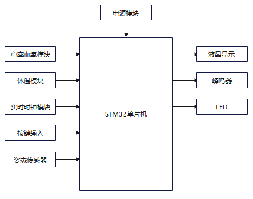
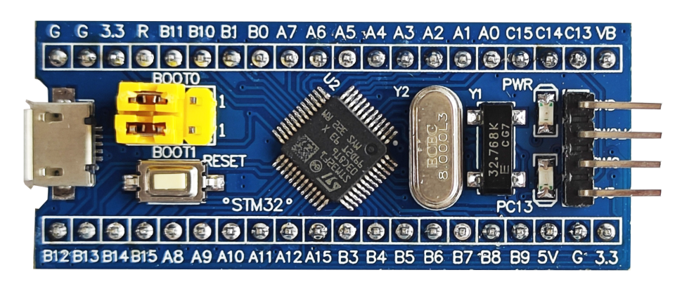
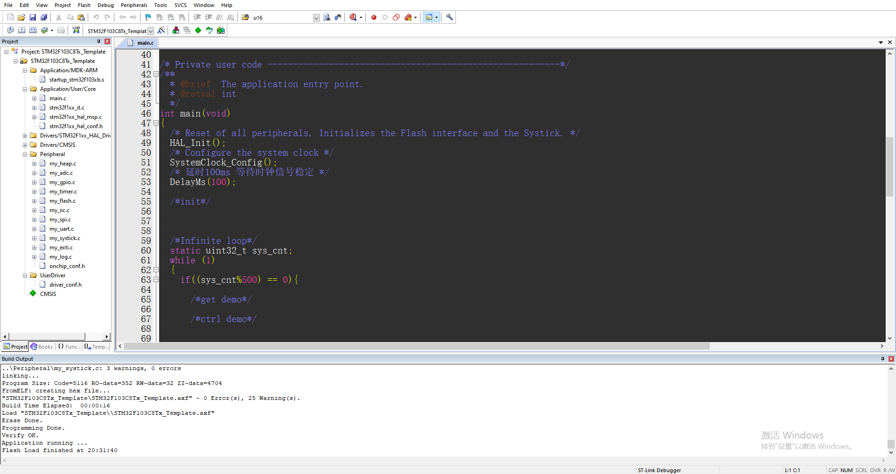
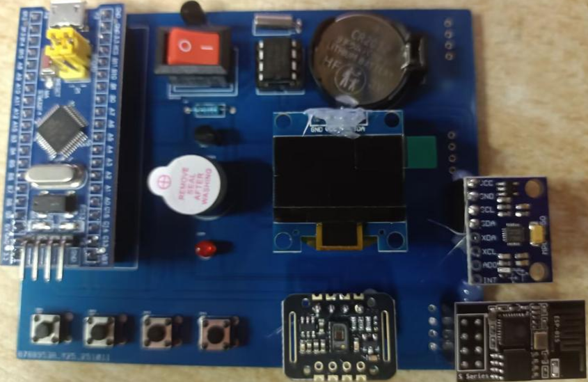
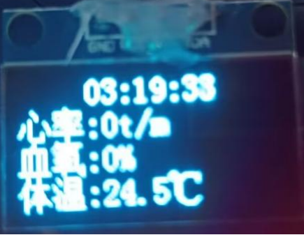
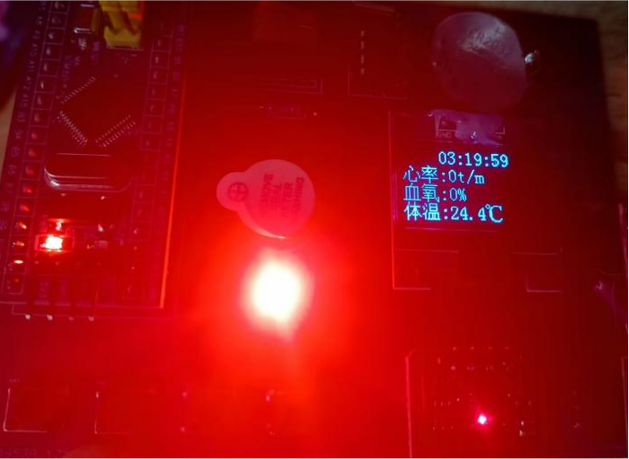

# 儿童健康监测智能手表

> 基于 STM32 的可穿戴健康监测设备，实现心率、血氧、体温实时监测与跌倒自动识别，支持本地声光报警与远程数据上传。

## 项目背景

面向儿童健康与安全监护场景，针对现有儿童智能手表存在的**监测功能单一、生理参数精度不足、跌倒检测误报率高**等问题，设计一款集生理参数监测、跌倒识别、远程报警于一体的可穿戴设备。

## 系统架构

```mermaid
flowchart TB
    subgraph 硬件层
        MCU["STM32F103C8T6 主控"]
        HR["MAX30102 心率血氧"]
        TEMP["DS18B20 体温"]
        IMU["MPU6050 六轴姿态"]
        WIFI["ESP8266 WiFi"]
        OLED["OLED 显示"]
        KEY["独立按键"]
        ALARM["蜂鸣器 + LED 报警"]
    end
    subgraph 软件层
        DRV["驱动层（I2C / 单总线 / 串口）"]
        ALG["算法层（滤波 / 跌倒识别 / 血氧计算）"]
        APP["应用层（阈值判断 / 报警 / 上传）"]
    end
    subgraph 云端
        CLOUD["MQTT 云平台"]
        MOBILE["手机 APP"]
    end
    MCU --- HR
    MCU --- TEMP
    MCU --- IMU
    MCU --- WIFI
    MCU --- OLED
    MCU --- KEY
    MCU --- ALARM
    WIFI --> CLOUD
    CLOUD --> MOBILE
硬件设计
| 模块 | 器件 | 接口 | 功能 |
| --- | --- | --- | --- |
| 主控 | STM32F103C8T6（Cortex-M3, 72MHz） | — | 数据采集、算法运算、逻辑控制 |
| 心率血氧 | MAX30102 | I2C | PPG 光电容积脉搏波，红光 660nm + 红外 880nm |
| 体温 | DS18B20 | 单总线 | 数字温度采集，精度 ±0.2℃ |
| 跌倒监测 | MPU6050 | I2C | 三轴加速度 + 三轴陀螺仪 |
| 通信 | ESP8266 | USART | WiFi 数据上传（MQTT） |
| 显示 | 0.96" OLED（SSD1306） | I2C | 实时数据展示 |
| 报警 | 有源蜂鸣器 + LED | GPIO | 声光同步报警（≥80dB） |
| 电源 | 3.7V 锂电池 + TP4056 | — | 充电管理 + 3.3V 稳压 |
PCB 采用 Altium Designer 双面板设计，遵循模拟/数字分区、电源线加粗、单点接地等抗干扰规范。
关键算法
1. 三级跌倒识别算法
为区分跌倒与日常活动（弯腰、跳跃、躺下），设计了三级串联判定逻辑：
第一级  冲击检测     → 合加速度突变（站立约 1g，跌倒瞬间突增）
第二级  姿态角判定   → 俯仰角 / 滚转角超出正常范围（±30°）
第三级  时间窗口验证 → 异常状态持续 > 300ms 才确认
2. 卡尔曼滤波姿态解算
以角速度作为预测值、加速度作为观测值，迭代融合，滤除肢体晃动与传感器噪声，输出平滑的姿态角，从数据源降低误判概率。
3. PPG 心率血氧测量
    心率：检测红外光 PPG 波形的周期性峰值，计算 BPM
    血氧：利用氧合/脱氧血红蛋白对红光、红外吸收度的差异，通过双波长 AC/DC 比值计算 SpO₂，配合滑动平均滤波消除运动伪影
测试结果
2. 卡尔曼滤波姿态解算

以角速度作为预测值、加速度作为观测值，迭代融合，滤除肢体晃动与传感器噪声，输出平滑的姿态角，从数据源降低误判概率。
3. PPG 心率血氧测量

    心率：检测红外光 PPG 波形的周期性峰值，计算 BPM
    血氧：利用氧合/脱氧血红蛋白对红光、红外吸收度的差异，通过双波长 AC/DC 比值计算 SpO₂，配合滑动平均滤波消除运动伪影

测试结果
| 指标 | 结果 | 设计要求 |
| --- | --- | --- |
| 心率误差 | ±2 次/分 | ≤±2 次/分 |
| 血氧误差 | ±3%（静坐 ±2.1%） | ≤±3% |
| 体温误差 | ±0.2℃ | ≤±0.2℃ |
| 跌倒响应时间 | 0.72s | <1s |
| 跌倒误报率 | 4.2% | ≤5% |
| 跌倒漏报率 | 2.1% | ≤3% |
| 续航 | >72h | >72h |
| WiFi 上传延迟 | <3s | ≤3s |
算法优化成果：通过「倾角 + 加速度」双阈值逻辑，将跌倒误判率从 4.86% 降至 1.25%。
工程结构
.
├── Core/               # CubeMX 生成的 HAL 初始化
├── Drivers/            # STM32 HAL 库
├── UserDriver/         # ★ 自研驱动（各传感器/通信模块）
├── Peripheral/         # 外设模块
├── MDK-ARM/            # Keil 工程文件
├── STM32F103C8Tx_Template.ioc   # CubeMX 工程配置
└── hardware/           # 原理图 + PCB（Altium Designer）
开发环境
    IDE：Keil MDK 5 + STM32CubeMX
    语言：C
    硬件设计：Altium Designer
    调试：SWD + 串口打印 + 万用表/示波器
已知局限与改进方向
    剧烈运动（摆臂）下血氧精度下降，需进一步优化滤波
    未集成 GPS 定位
    传感器校准可进一步优化
```markdown
实物展示

| 总体框图 | PCB 设计 | 硬件调试 |
|---|---|---|
|  |  |  |

| 整体实物 | OLED 显示 | 跌倒测试 |
|---|---|---|
|  |  |  |